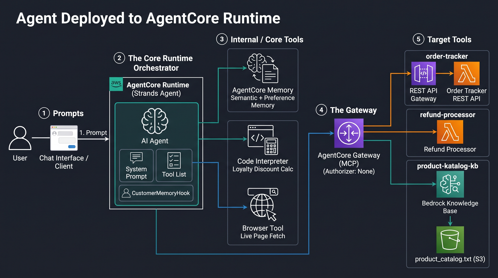
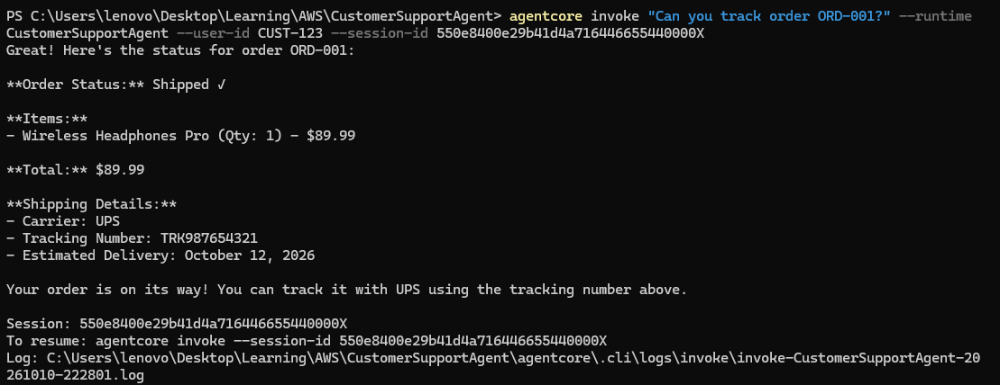
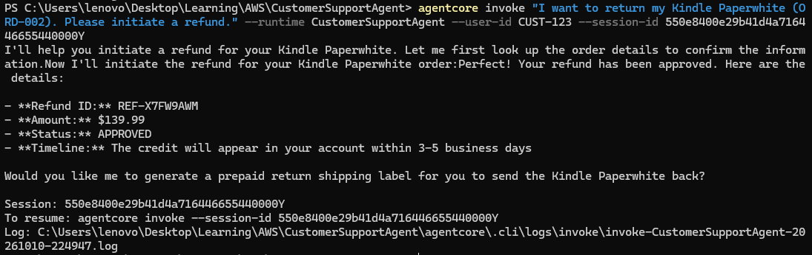
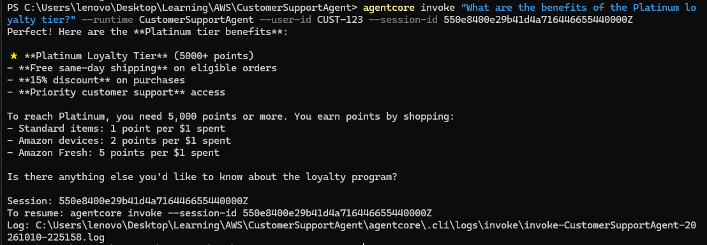
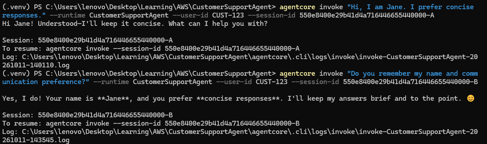
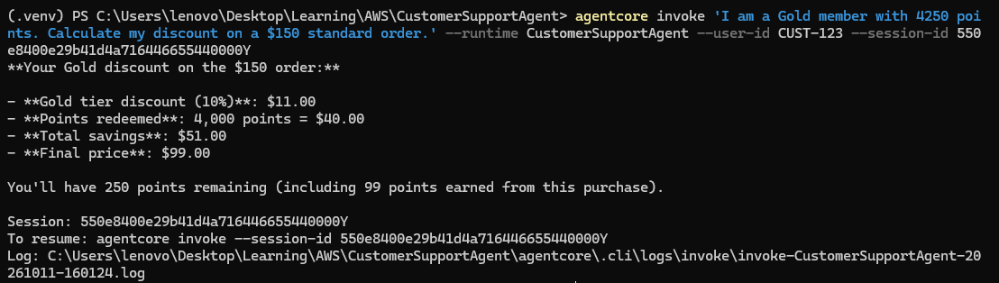
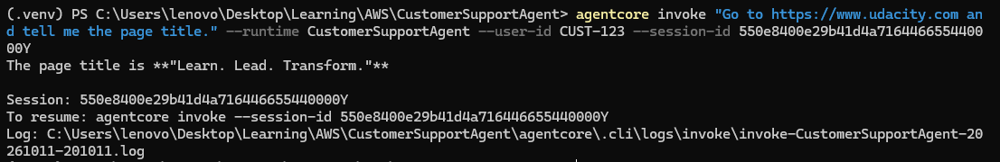

# Customer Support Agent — Project Documentation

An AI customer support agent built on Amazon Bedrock AgentCore and the Strands SDK, using the new `@aws/agentcore` CLI.

## What the agent does

The agent is a conversational customer support assistant for an e-commerce platform. It handles six capabilities through a single chat interface:

- **Order tracking** — looks up order status, tracking number, and carrier via a Lambda function exposed behind a REST API Gateway.
- **Refund processing** — initiates refunds, checks refund status, and generates return labels via a direct Lambda function invocation.
- **Product and policy Q&A (RAG)** — answers questions about products, return policies, warranties, and loyalty tier benefits by retrieving grounded passages from a Bedrock Knowledge Base
- **Cross-session memory** — recalls a customer's name and stated preferences across separate conversations using AgentCore Memory
- **Loyalty discount calculation** — computes exact point redemption and tier discounts in a secure Code Interpreter sandbox, never estimated by the model itself
- **Live web browsing** — fetches real-time information from a live web page using the AgentCore Browser tool

Built with the Strands SDK on Amazon Bedrock AgentCore, deployed and managed end-to-end with the new `@aws/agentcore` CLI rather than the legacy `bedrock-agentcore-starter-toolkit`.

## Architecture



The Gateway fronts the REST API-backed tool (order-tracker), the direct Lambda tool (refund-processor), and the Knowledge Base connector over MCP; Memory, Code Interpreter, and the Browser tool are called directly from agent code via their respective AWS SDKs, with no Gateway involved.

## Tech stack

| Layer                | Technology                                                        |
| -------------------- | ----------------------------------------------------------------- |
| Agent framework      | Strands SDK (`strands-agents`)                                    |
| Deployment / hosting | Amazon Bedrock AgentCore Runtime                                  |
| CLI / IaC            | `@aws/agentcore` CLI (Node), CDK under the hood                   |
| Language             | Python 3.13/3.14, `uv` for dependency management                  |
| Tool integration     | AgentCore Gateway (MCP, Model Context Protocol)                   |
| Backend compute      | AWS Lambda (order tracking, refund processing)                    |
| API layer            | Amazon API Gateway (REST, proxy integration)                      |
| RAG                  | Bedrock Knowledge Base + S3 data source                           |
| Memory               | AgentCore Memory (semantic + user-preference strategies)          |
| Code execution       | AgentCore Code Interpreter                                        |
| Web browsing         |AgentCore Browser (boto3 BrowserClient + raw Chrome DevTools Protocol over WebSocket) |
| Region               | eu-west-1 (Ireland)                                               |

## Project structure

```
CustomerSupportAgent/
├── agentcore/
│   ├── agentcore.json          # desired-state config: runtime, gateway, targets, memory, KB
│   ├── .cli/
│   │   └── deployed-state.json # actual provisioned resource IDs/ARNs (CLI-internal)
│   └── cdk/                    # generated CDK stack
├── app/
│   └── CustomerSupportAgent/
│       ├── main.py             # entrypoint, agent factory, system prompt, tool list
│       ├── pyproject.toml      # dependency manifest (uv-managed)
│       ├── model/
│       │   └── load.py
│       ├── mcp_client/
│       │   └── client.py       # Gateway MCP client (reads AGENTCORE_GATEWAY_*_URL)
│       ├── memory/
│       │    ├── namespaces.py   # namespace template resolution (live, from Memory resource)
│       │    └── hooks.py        # CustomerMemoryHook — retrieve + save per turn
│       └─ tools/
│           ├── loyalty.py       # calculate_loyalty_discount (Code Interpreter)
│           └── browse.py        # browse_page: AgentCore Browser via boto3 + raw CDP over WebSocket
├── lambda-src/
│   ├── order_tracker.py        # deployed via API Gateway REST proxy
│   ├── refund_processor.py     # deployed directly as a Gateway Lambda target
│   └── lambda_schema           # tool schema for refund_processor's 3 tools
│
├── product_catalog.txt         # uploaded to S3, source for the Knowledge Base
│
└── screenshots/                # screenshots for README
```

## Prerequisites

- An AWS account with Bedrock model access enabled in your target region
- Node.js 20+ (`npm install -g @aws/agentcore`)
- `uv` for Python dependency management (`curl -LsSf https://astral.sh/uv/install.sh | sh`)
- AWS CLI configured (`aws configure`) with credentials for an IAM user or role that can run CDK deployments
- `cdk bootstrap` run at least once for your account/region (`npx cdk bootstrap aws://<account-id>/<region>`)

## Setup

### 1. Scaffold the project

```bash
agentcore create \
  --name CustomerSupportAgent \
  --framework Strands \
  --model-provider Bedrock \
  --memory none \
  --build CodeZip

cd CustomerSupportAgent
agentcore dev   # sanity check — bare agent should respond
```

### 2. Deploy the Lambda functions

```bash
cd lambda-src
zip order_tracker.zip order_tracker.py
zip refund_processor.zip refund_processor.py

aws lambda create-function --function-name order-tracker \
  --runtime python3.14 --handler order_tracker.lambda_handler \
  --role arn:aws:iam::<account-id>:role/<execution-role> \
  --zip-file fileb://order_tracker.zip

aws lambda create-function --function-name refund-processor \
  --runtime python3.14 --handler refund_processor.lambda_handler \
  --role arn:aws:iam::<account-id>:role/<execution-role> \
  --zip-file fileb://refund_processor.zip
```

### 3. Create the API Gateway REST API (for order-tracker)

Create the following resources with Lambda proxy integration to the `order-tracker` Lambda function:

| Method and resource                   | Operation name        |
| ------------------------------------- | --------------------- |
| `GET /orders/{order_id}`              | `get_order`           |
| `GET /customers/{customer_id}/orders` | `get_customer_orders` |
| `GET /customers/{customer_id}`        | `get_customer`        |

Deploy to a stage (e.g. `prod`) and redeploy after any method change.

### 4. Add the Gateway and its targets

```bash
agentcore add gateway --name CustomerSupportGateway --authorizer none

agentcore add gateway-target \
  --gateway CustomerSupportGateway --type api-gateway \
  --name order-tracker --rest-api-id <rest-api-id> --stage prod

agentcore add gateway-target \
  --gateway CustomerSupportGateway --type lambda-function-arn \
  --name refund-processor \
  --lambda-arn arn:aws:lambda:<region>:<account-id>:function:refund-processor \
  --tool-schema-file lambda-src/lambda_schema.json

agentcore deploy
```

### 5. Add the Knowledge Base

```bash
aws s3 cp product_catalog.txt s3://<your-bucket>/product_catalog.txt

agentcore add knowledge-base --name CustomerSupportKB \
  --source s3://<your-bucket>/product_catalog.txt

agentcore deploy   # provisions the KB and mints a real knowledge-base-id

agentcore add gateway-target \
  --gateway CustomerSupportGateway --type connector \
  --connector bedrock-knowledge-bases --knowledge-base-id <kb-id> \
  --name product-catalog-kb \
  --description "Search the product catalog and support knowledge base for product specs, return policies, warranty terms, and loyalty program tier benefits"

agentcore deploy
```

### 6. Add Memory

```bash
agentcore add memory --name CustomerSupportMemory \
  --strategies "SEMANTIC,USER_PREFERENCE"

agentcore deploy
```

### 7. Add project dependencies

In `app/CustomerSupportAgent/pyproject.toml`, add:

```
"websockets >= 14.0",
```

### 8. Implement the agent code

See [Project structure](#project-structure) above for where each piece lives:

- `mcp_client/client.py` — reads the Gateway URL from `AGENTCORE_GATEWAY_CUSTOMERSUPPORTGATEWAY_URL` (auto-injected by CDK)
- `memory/namespaces.py` + `memory/hooks.py` — `CustomerMemoryHook`, reading live strategy metadata via `MemoryClient.get_memory_strategies()`
- `tools/loyalty.py` — `calculate_loyalty_discount`, using AgentCore Code Interpreter
- `tools/browse.py` — `browse_page`, which starts a managed AgentCore Browser session with boto3's `BrowserClient` and drives it with raw Chrome DevTools Protocol over a WebSocket, in a dedicated thread
- `main.py` — wires everything into the Strands Agent, adds the browser tool, resolves `actor_id` from the invoke payload, sets the system prompt

### 9. Grant the runtime role access to Code Interpreter and Browser

The runtime's execution role is created by CDK and only covers resources declared in agentcore.json. Code Interpreter and Browser are not declared there. Add these statements to the existing role.

```json
{
  "Action": [
    "bedrock-agentcore:StartCodeInterpreterSession",
    "bedrock-agentcore:StopCodeInterpreterSession",
    "bedrock-agentcore:InvokeCodeInterpreter"
  ],
  "Resource": "arn:aws:bedrock-agentcore:eu-west-1:aws:code-interpreter/aws.codeinterpreter.v1",
  "Effect": "Allow"
},
{
  "Sid": "Browser",
  "Effect": "Allow",
  "Action": [
    "bedrock-agentcore:StartBrowserSession",
    "bedrock-agentcore:StopBrowserSession",
    "bedrock-agentcore:GetBrowserSession",
    "bedrock-agentcore:ListBrowserSessions",
    "bedrock-agentcore:ConnectBrowserAutomationStream",
    "bedrock-agentcore:ConnectBrowserLiveViewStream",
    "bedrock-agentcore:UpdateBrowserStream"
  ],
  "Resource": [
    "arn:aws:bedrock-agentcore:eu-west-1:aws:browser/aws.browser.v1",
    "arn:aws:bedrock-agentcore:eu-west-1:692707726425:browser/*"
  ]
}
```

### 10. Deploy and verify

```bash
agentcore deploy

# confirm injected env vars landed
aws bedrock-agentcore-control get-agent-runtime \
  --agent-runtime-id <runtime-id> \
  --query 'environmentVariables' --output json --region <region>
```

## Screenshots

Test commands run via `agentcore invoke`, with `--user-id CUST-123` and a session ID of 33+ characters as required by the runtime.

### Test 1 — Order Tracking



Expected: shipping status, tracking number `TRK987654321`, carrier UPS, estimated delivery date.

### Test 2 — Refund Processing



Expected: refund ID, `APPROVED` status, "3-5 business days" message.

### Test 3 — Knowledge Base (RAG)



Expected: free same-day shipping, 15% discount, priority support (retrieved from the Knowledge Base).

### Test 4 — Long-Term Memory (both sessions)



Expected: in session B, the agent recalls the customer's name and stated communication preference from session A.

### Test 5 — Loyalty Discount Calculation



Expected: points redeemed, tier discount rate, correct final total, remaining points.

### Test 6 — Browser Tool



Expected: page title retrieved from the live page.

## Cleanup

### 1. Remove the AgentCore resources

`agentcore remove` edits the project config only, and there is no `agentcore destroy` command. Remove the targets before the gateway that owns them, then apply the change with agentcore deploy so CDK deletes the resources:

```bash
agentcore remove gateway-target   # order-tracker, refund-processor, product-catalog-kb
agentcore remove gateway
agentcore remove knowledge-base
agentcore remove memory
agentcore remove agent            # the runtime
agentcore deploy
```

`agentcore remove all` resets the whole project config in one step

Afterwards, open the CloudFormation console: if the `AgentCore-CustomerSupportAgent-default` stack still exists, delete it there, and confirm in the Bedrock console that the Gateway, Memory, Knowledge Base, and runtime are gone.

### 2. Delete what the CLI does not manage

- **S3 bucket**: empty and delete the bucket holding `product_catalog.txt`
- **Vector store*: deleting a Knowledge Base can leave its storage behind. Check Amazon OpenSearch Service → Serverless → Collections for an auto-created collection and delete it, since it bills while it exists
- **API Gateway**: delete the REST API created for order-tracker
- **Lambda**: delete `order-tracker` and `refund-processor`
- **CloudWatch**: delete the log groups for the two functions and the runtime (optional)

### 3. IAM (optional)

- Delete the execution roles created for the Lambda functions and, if the console created them, for the Knowledge Base. Inline policies you attached to the runtime role go away with it
- Remove any inline policies you attached to your own IAM user, such as memory read access used for local debugging
- Leave the CDK bootstrap stack (`CDKToolkit`) in place, since other CDK projects in the account share itDeleting the Knowledge Base does not automatically delete its underlying storage.


## Key decisions

- **Memory namespace templates resolved live, not hardcoded.** Rather than duplicate the namespace template strings from `agentcore.json` into agent code (a drift risk if the Memory resource is reconfigured), `memory/namespaces.py` calls `MemoryClient.get_memory_strategies()` at runtime (cached) so the agent always reflects the Memory resource's actual configuration.
- **Code Interpreter does the loyalty arithmetic, not the model.** `calculate_loyalty_discount` builds and executes a Python code string in the sandbox rather than letting the LLM compute point redemption and tier discounts itself — exact arithmetic, not an approximation, with a tier-only fallback if the sandbox is unavailable.
- **Agent/session cache keyed by `(session_id, actor_id)`**, not `session_id` alone — a defensive choice to prevent two different customers' conversation state or memory hook from ever colliding if session IDs were reused.
- **Browser tool**: raw CDP instead of Strands' `AgentCoreBrowser`. The Strands wrapper replaces the asyncio event loop when constructed, which crashed the ASGI server under Python 3.14 (an upstream issue open at the time of writing). `tools/browse.py` instead starts the managed session with boto3's `BrowserClient` and drives it with raw Chrome DevTools Protocol messages over a WebSocket, in a dedicated thread with its own event loop. It also drops Playwright, which cannot run in the runtime's read-only container.
- **Memory fails soft**. The memory hook wraps retrieval and saving in try/except and logs tracebacks, so a Memory problem degrades an answer instead of failing the request. The cost is that failures surface only in logs, so they need alerting in production.
- **Least-privilege tool permissions**. Code Interpreter access is granted as a scoped inline policy on the runtime role, not through the managed `AgentCoreFullAccess` policy, which includes delete actions that an agent reading untrusted web content should not hold.
